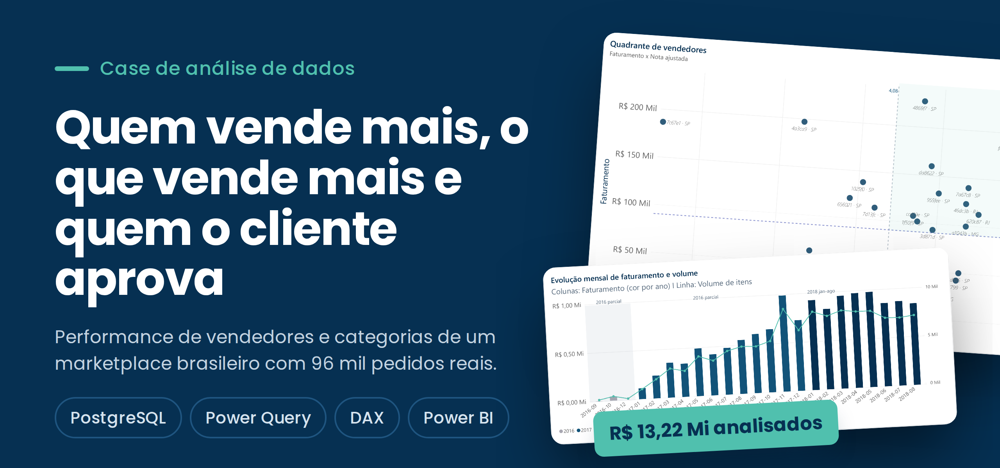
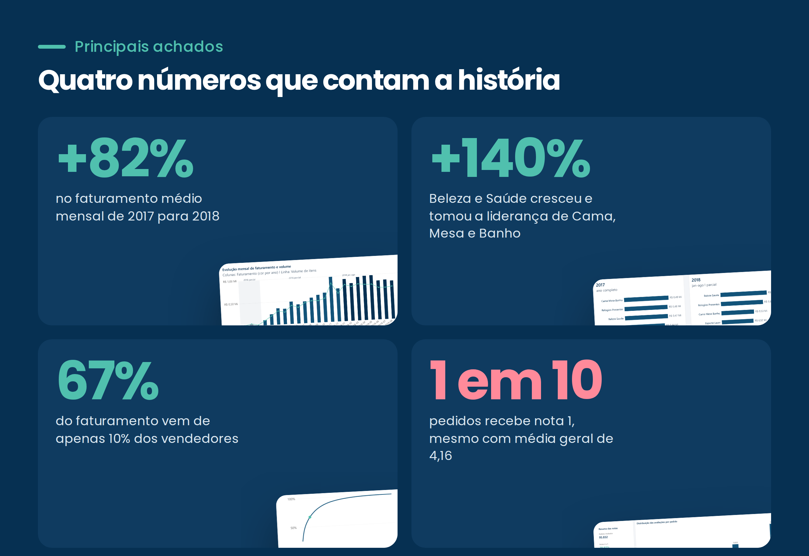
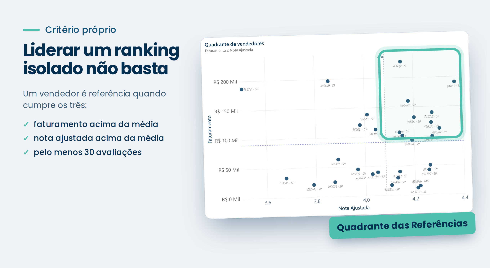
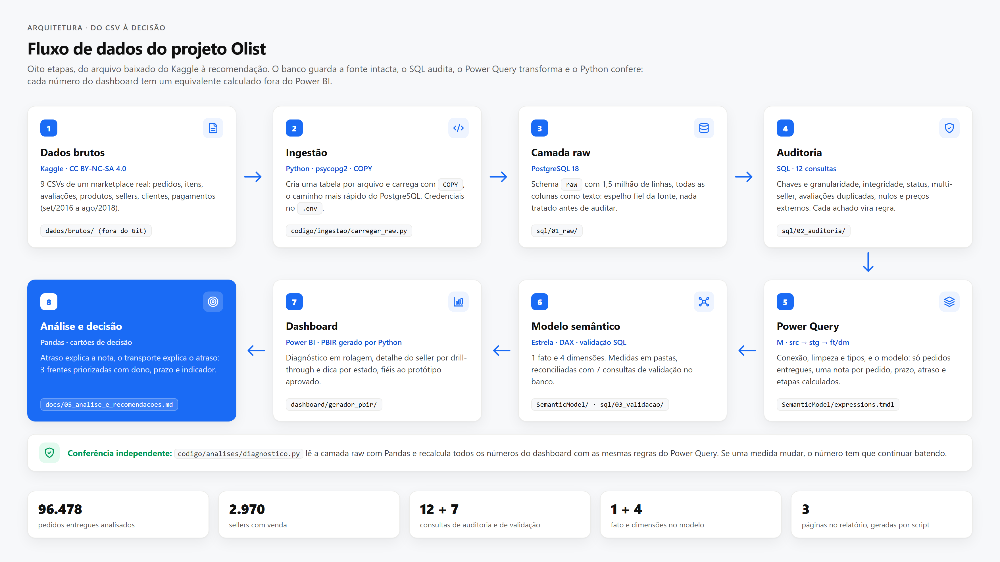
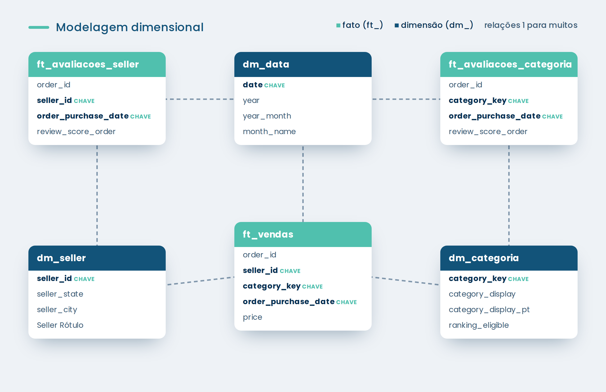
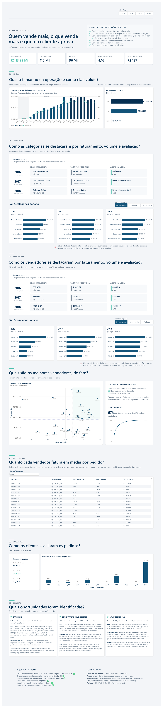

<p align="center">
  
</p>

<p align="center">
  
  
  
  
</p>

Análise de performance de **vendedores e categorias** de um marketplace brasileiro, construída a partir de um desafio técnico de análise de dados. O projeto vai do banco de dados ao dashboard: carga no PostgreSQL, tratamento em camadas no Power Query, modelagem dimensional, métricas em DAX e um relatório no Power BI organizado em perguntas de negócio.

Os dados são do [Brazilian E-Commerce Public Dataset by Olist](https://www.kaggle.com/datasets/olistbr/brazilian-ecommerce), com pedidos reais e anonimizados de set/2016 a ago/2018.

> 📄 **Dashboard completo:** [`dashboard/`](dashboard/) · 🧮 **Todas as medidas DAX:** [`docs/medidas-dax.md`](docs/medidas-dax.md) · 🔧 **Consultas Power Query:** [`power-query/`](power-query/)

---

## O desafio

Identificar os melhores vendedores e categorias do marketplace, com critérios próprios, e responder:

1. Quais as melhores **categorias** por ano, sob três perspectivas: maior faturamento, maior volume de itens vendidos e maior nota média.
2. Quais os melhores **vendedores** por ano, sob as mesmas três perspectivas.
3. Qual o **ticket médio** de cada vendedor.

Requisitos técnicos: modelagem no Power Query com tabelas fato (`ft_`) e dimensão (`dm_`), e visuais que comuniquem as conclusões à primeira vista, sem depender só de tabelas.

## Em números

| Faturamento | Itens vendidos | Pedidos | Ticket médio | Nota média |
|:---:|:---:|:---:|:---:|:---:|
| **R$ 13,22 Mi** | **110 mil** | **96 mil** | **R$ 137** | **4,16** |

---

## Principais achados

<p align="center"></p>

Cada insight do relatório segue a estrutura **fato → interpretação → ação**.

**📈 A operação quase dobrou de ritmo.** O faturamento médio mensal cresceu 82% de 2017 para 2018. Como 2016 e 2018 têm cobertura parcial, a comparação é feita por mês e não por total anual.

**💄 A demanda está migrando entre categorias.** Beleza e Saúde saiu de R$ 39 mil/mês em 2017 para R$ 94 mil/mês em 2018 (+140%) e tomou a liderança. Cama, Mesa e Banho, líder de 2017, cresceu só 62%, abaixo dos 82% do marketplace.
*Ação:* priorizar campanhas e captação de vendedores em Beleza e Relógios, e investigar a desaceleração de Cama, Mesa e Banho (preço, sortimento ou concorrência).

**🏆 A receita depende de poucos vendedores.** Os 10% maiores vendedores geram R$ 8,86 Mi dos R$ 13,22 Mi (67%). Em média, cada um deles fatura cerca de 18 vezes mais que um vendedor do restante da base.
*Ação:* acompanhamento dedicado ao topo (retenção, prazos, qualidade) e um programa de desenvolvimento para o grupo logo abaixo, reduzindo a dependência.

**⭐ A média alta esconde uma experiência ruim.** Com nota média de 4,16, 59% dos pedidos receberam nota 5, mas 10% (9.313 pedidos) receberam nota 1. A nota 2 aparece em só 3%: o cliente avalia nos extremos.
*Ação:* investigar os pedidos com nota 1 (atraso, produto errado, vendedor específico) e agir onde eles se concentram.

---

## Quem é o melhor vendedor, de fato?

<p align="center"></p>

Liderar o ranking de faturamento não basta. Um vendedor que fatura muito com clientes insatisfeitos é um risco, e um com nota 5 em três avaliações não é comparável a um com 4,7 em mil. O critério combina as duas dimensões:

- faturamento acima da média dos vendedores
- nota ajustada acima da média
- pelo menos 30 avaliações

Quem cumpre os três fica no quadrante **Referências**: vende muito sem sacrificar a experiência do cliente.

### Nota ajustada (média bayesiana)

A nota média simples favorece quem tem poucas avaliações. A nota ajustada puxa a média de cada vendedor em direção à média geral do período, com mais força quanto menos avaliações ele tiver:

```
nota ajustada = N / (N + m) × média do vendedor  +  m / (N + m) × média geral
```

`N` é o número de avaliações do vendedor e `m` funciona como um número de avaliações "virtuais" com a média geral (13,88 para vendedores e 16,36 para categorias). Com poucas avaliações, a nota fica perto da média geral; com muitas, prevalece a nota real.

```dax
Nota Ajustada Seller =
VAR N = [Qtd Avaliações Seller]
VAR MediaSeller = [Nota Média Seller]
VAR MediaGeralAno =
    CALCULATE ( [Nota Média Seller], REMOVEFILTERS ( dm_seller ) )
VAR M = 13.88
RETURN
    IF (
        N = 0,
        BLANK (),
        DIVIDE ( N, N + M ) * MediaSeller
            + DIVIDE ( M, N + M ) * MediaGeralAno
    )
```

O `REMOVEFILTERS(dm_seller)` tira o filtro do vendedor, mas mantém o filtro de ano. Assim, cada vendedor é comparado com a média do mesmo período.

---

## Como foi construído

<p align="center"></p>

| Camada | O que faz |
|---|---|
| **PostgreSQL** (`raw`) | Recebe as tabelas originais do dataset: pedidos, itens, produtos, vendedores, avaliações e tradução de categorias. |
| **`src_`** | Uma consulta por tabela do banco, só com a conexão. Se a fonte mudar, muda em um lugar. |
| **`stg_`** | Limpeza e padronização: seleção de colunas, tipos (com localidade `en-US` para os valores), limpeza de texto e a nota consolidada por pedido. |
| **`ft_` / `dm_`** | Modelo dimensional consumido pelo relatório. |
| **DAX** | 29 medidas centralizadas na tabela `_Medidas`, mais parâmetros de campo para os botões "ver ranking por". |

---

## Modelagem dimensional

<p align="center"></p>

Três tabelas fato com granularidades diferentes, compartilhando três dimensões:

| Tabela | Granularidade | Uso |
|---|---|---|
| `ft_vendas` | 1 linha por item de pedido entregue | Faturamento, volume de itens, pedidos e ticket médio |
| `ft_avaliacoes_seller` | 1 linha por par vendedor + pedido avaliado | Notas por vendedor |
| `ft_avaliacoes_categoria` | 1 linha por par categoria + pedido avaliado | Notas por categoria |
| `dm_seller` | 1 linha por vendedor | ID, cidade, UF e rótulo abreviado |
| `dm_categoria` | 1 linha por categoria | Nomes em inglês e português, e flag de elegibilidade para ranking |
| `dm_data` | 1 linha por dia | Calendário gerado no Power Query entre a primeira e a última compra |

**Por que fatos de avaliação separadas?** Um pedido pode ter itens de vários vendedores e categorias. Se a nota ficasse em `ft_vendas` (nível de item), um pedido com cinco itens contaria sua nota cinco vezes. Separar as avaliações garante que cada pedido pese uma vez para cada vendedor e para cada categoria.

---

## Decisões de dados

| Decisão | Motivo |
|---|---|
| Apenas pedidos com status **entregue** | Pedidos cancelados ou em trânsito não representam venda concluída. |
| **Faturamento = soma do preço dos itens, sem frete** | O frete não é receita do vendedor pelo produto. |
| **Nota por pedido = média das avaliações do pedido** | Alguns pedidos têm mais de uma avaliação. É por isso que existem notas como 3,33 e 4,50 na distribuição. |
| Categoria vazia vira **"Não informado"** e fica fora dos rankings | Mantém o faturamento no total sem premiar uma categoria que não existe (coluna `ranking_eligible`). |
| Comparação entre anos **por mês** | 2016 (set–dez) e 2018 (jan–ago) são parciais. |

---

## Dashboard

O relatório é uma página contínua em 7 seções, cada uma respondendo uma pergunta:

1. Resumo executivo
2. Qual o tamanho da operação e como ela evoluiu?
3. Como as categorias se destacaram por faturamento, volume e avaliação?
4. Como os vendedores se destacaram por faturamento, volume e avaliação? Quem são os melhores, de fato?
5. Quanto cada vendedor fatura em média por pedido?
6. Como os clientes avaliaram os pedidos?
7. Quais oportunidades foram identificadas?

<details>
<summary><b>Ver o dashboard completo</b></summary>
<br>

</details>

---

## Estrutura do repositório

```
├── README.md
├── assets/              imagens do README
├── dashboard/           arquivo .pbix e PDF do relatório
├── docs/
│   └── medidas-dax.md   todas as medidas, colunas e tabelas calculadas
└── power-query/         consultas M (src_, stg_, ft_, dm_)
```

## Como reproduzir

1. Baixe o dataset no [Kaggle](https://www.kaggle.com/datasets/olistbr/brazilian-ecommerce).
2. Carregue as tabelas `orders`, `order_items`, `products`, `sellers`, `order_reviews` e `product_category_translation` em um banco PostgreSQL, no schema `raw`.
3. Abra o `.pbix` da pasta `dashboard/` no Power BI Desktop e ajuste o servidor e o banco nas consultas `src_` (Página Inicial → Transformar dados → Configurações da fonte de dados).
4. Atualize os dados.

---

## Autor

**Matheus Mendes** — Estudante de Análise e Desenvolvimento de Sistemas (ADS), com foco em **Dados, Engenharia de Dados e Business Intelligence**.

**Stack:** Python · SQL · MySQL · ETL · Data Warehouse · Power BI · DAX

**Certificações:** CPA-10 · CPA Pro R — ANBIMA 

[LinkedIn]((https://www.linkedin.com/in/matheusmendes-dados/) · [GitHub](https://github.com/matheusmendesgestaopessoal)
