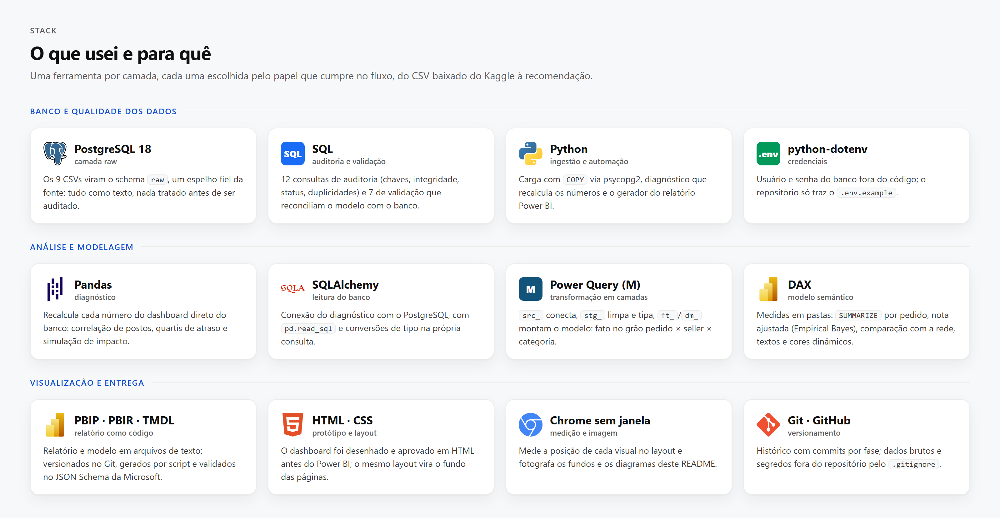
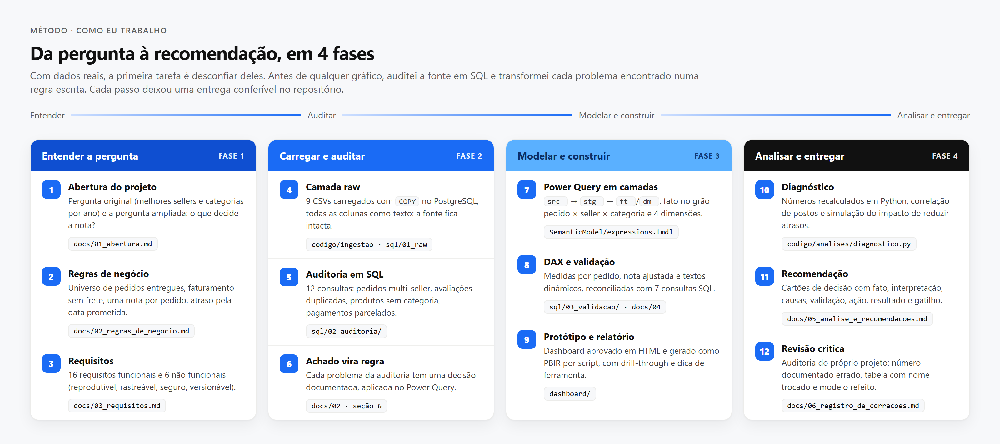
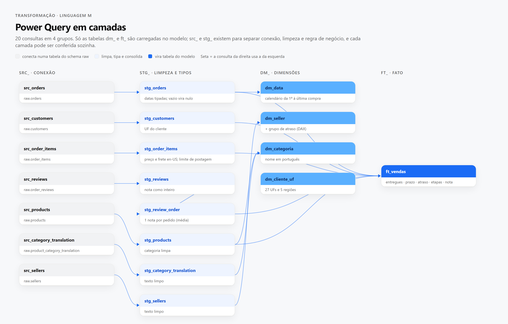
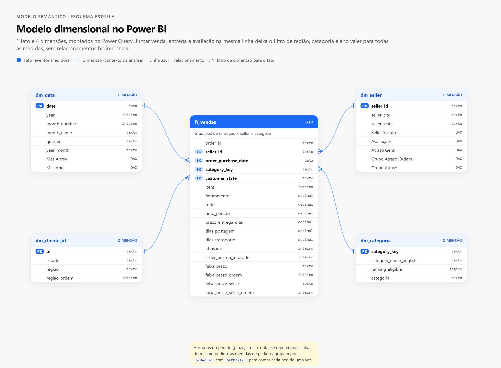
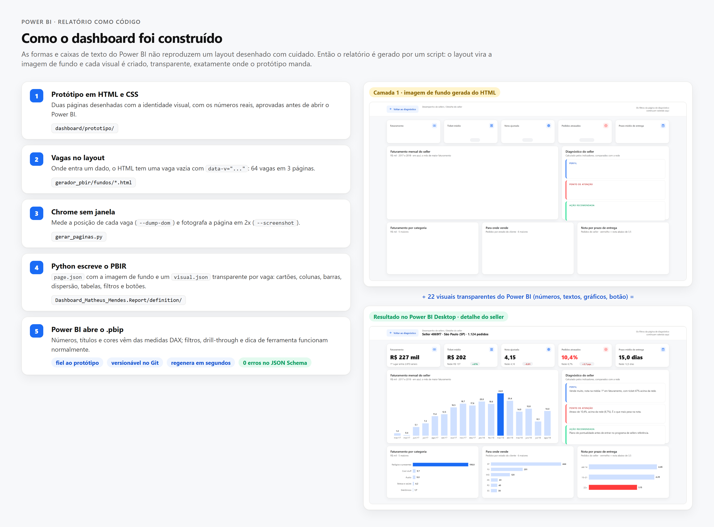
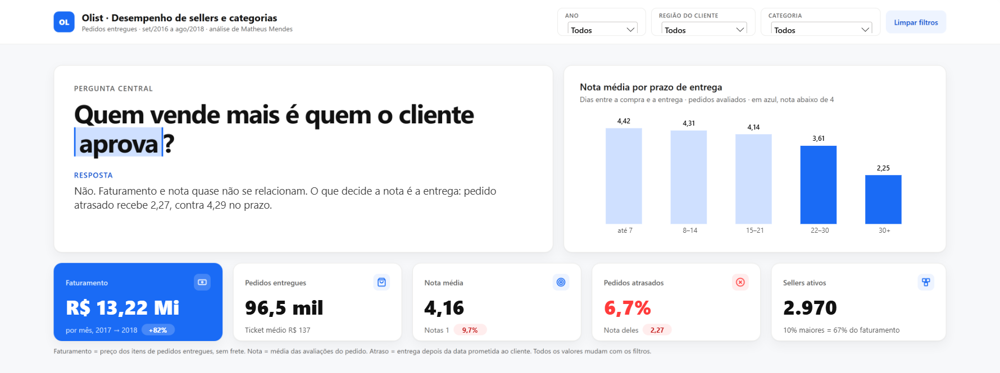
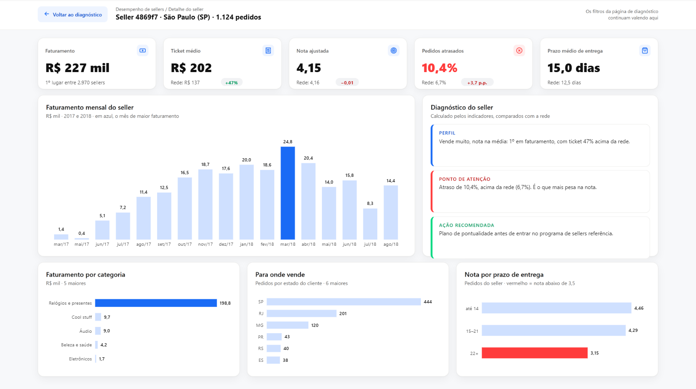
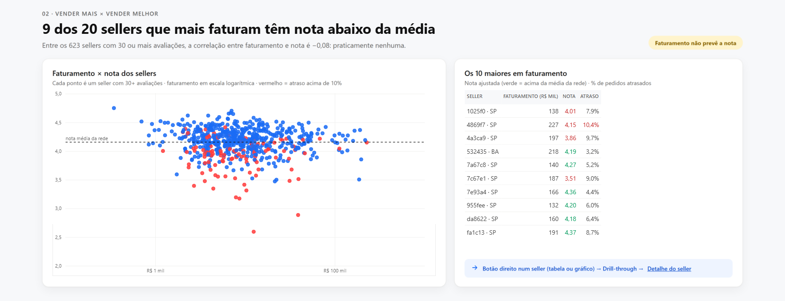
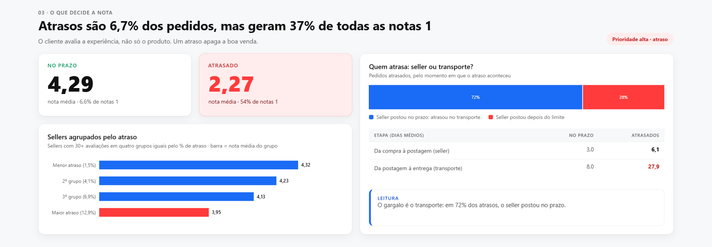

<p align="center">
  
  
  
  
  
  
</p>

<p align="center">
  <a href="https://matheusmendes.site/projetos/olist"></a>
  <a href="https://matheusmendes.site/downloads/olist-dashboard.zip"></a>
</p>

<p align="center">
  <a href="#-arquitetura">Arquitetura</a> ·
  <a href="#-sql-e-postgresql">SQL</a> ·
  <a href="#-python">Python</a> ·
  <a href="#-power-query-e-modelagem">Power Query</a> ·
  <a href="#-dax-e-power-bi">DAX e Power BI</a> ·
  <a href="#-documentação">Documentação</a> ·
  <a href="#-decisões-técnicas">Decisões</a> ·
  <a href="#-como-executar">Executar</a>
</p>

## Sobre o projeto

Análise de sellers e categorias de um marketplace brasileiro com **dados reais**: 1,5 milhão de linhas do [dataset público da Olist](https://www.kaggle.com/datasets/olistbr/brazilian-ecommerce) (set/2016 a ago/2018). Carreguei os dados no PostgreSQL, auditei a fonte em SQL, modelei em camadas no Power Query, escrevi o modelo semântico em DAX, gerei o relatório do Power BI por código e conferi cada número em Python.

> **Pergunta original:** quais são os melhores sellers e categorias por ano, em faturamento, volume e nota?
> **Pergunta que a análise levantou:** os campeões de faturamento nunca são os de nota. Então, **quem vende mais é quem o cliente aprova?**
> **Resposta:** não. Faturamento e nota quase não se relacionam; o que decide a nota é a **entrega** (atrasado 2,27 contra 4,29 no prazo), e 72% dos atrasos acontecem no transporte. [Análise completa](docs/05_analise_e_recomendacoes.md)

O foco deste README é **como foi feito**: as ferramentas, por que cada uma e as decisões técnicas no caminho. A história contada visualmente com o dashboard está na [**apresentação no meu portfólio**](https://matheusmendes.site/projetos/olist).



---

## 🧭 Como eu trabalhei

Com dados reais, a primeira tarefa é desconfiar deles. Antes de qualquer gráfico, auditei a fonte e transformei cada problema encontrado numa regra escrita.



---

## 🏗 Arquitetura

O banco guarda a fonte intacta, o SQL audita, o Power Query transforma e o Python confere.


---

## 🗄 SQL e PostgreSQL

**Por que uma camada raw:** os 9 CSVs entram no schema `raw` com todas as colunas como texto, sem nenhuma regra aplicada. Assim a fonte fica intacta e qualquer número pode ser rastreado até ela; as regras ficam num só lugar (Power Query) e são conferidas no banco.

**Auditoria · 12 consultas** ([`sql/02_auditoria/`](sql/02_auditoria/)). Cada achado virou uma regra documentada:

| Achado | Evidência | Decisão |
|---|---|---|
| Pedidos com mais de um seller | 1.278 pedidos | Faturamento por item, nunca pelo total do pedido |
| Pedidos com várias avaliações | 547 pedidos, 202 com notas diferentes | Uma nota por pedido (média) antes de ligar a sellers e categorias |
| Itens em pedidos cancelados | 461 pedidos | Universo = pedidos entregues |
| Produtos sem categoria | 610 produtos, R$ 170,7 mil | "Não informado", fora dos rankings |
| Pagamentos parcelados ou múltiplos | até 29 linhas por pedido | `payment_value` não é faturamento |
| Amostras desiguais de avaliação | 534 sellers com 1 pedido avaliado | Nota ajustada e mínimo de 30 avaliações |

```sql
-- sql/02_auditoria/05_reviews_por_pedido.sql · por que não ligar itens e avaliações direto
WITH reviews_por_pedido AS (
    SELECT order_id, COUNT(*) AS n_reviews, COUNT(DISTINCT review_score) AS n_notas_distintas
    FROM raw.order_reviews
    GROUP BY order_id
)
SELECT COUNT(*) FILTER (WHERE n_reviews > 1)         AS pedidos_com_varias_reviews,
       COUNT(*) FILTER (WHERE n_notas_distintas > 1) AS pedidos_com_notas_diferentes
FROM reviews_por_pedido;
```

**Validação · 7 consultas** ([`sql/03_validacao/`](sql/03_validacao/)) reconciliam o modelo com o banco: faturamento e avaliações, rankings de categorias e sellers, ticket médio, nota ajustada e concentração. CTEs, `FILTER`, agregações e conversão de tipos (`::NUMERIC`, `::TIMESTAMP`) sobre a camada de texto.

---

## 🐍 Python

**Por que Python:** carregar 1,5 milhão de linhas de forma repetível e ter uma segunda fonte de verdade para os números, independente do Power BI.

| Script | O que faz | Técnicas |
|---|---|---|
| [`codigo/ingestao/carregar_raw.py`](codigo/ingestao/carregar_raw.py) | Cria uma tabela por CSV e carrega no schema `raw` | psycopg2, `COPY FROM STDIN` (bem mais rápido que `INSERT` linha a linha), nomes com `sql.Identifier`, credenciais no `.env` |
| [`codigo/analises/diagnostico.py`](codigo/analises/diagnostico.py) | Recalcula todos os números do dashboard e da análise | Pandas, SQLAlchemy, correlação de postos, quartis com `qcut`, simulação de impacto |
| [`dashboard/gerador_pbir/gerar_paginas.py`](dashboard/gerador_pbir/gerar_paginas.py) | Gera as páginas do relatório Power BI | JSON (PBIR), Chrome sem janela, clonagem de modelos de visual |

```python
# codigo/analises/diagnostico.py · o que decide a nota
av = ent.dropna(subset=["nota", "entrega"])
g = av.groupby("atraso").agg(pedidos=("order_id", "size"), nota=("nota", "mean"),
                             nota1=("nota", lambda x: (x.round() == 1).mean()))
um = av[av.nota.round() == 1]
print(f"atrasados: {av.atraso.mean():.1%} dos pedidos e {um.atraso.mean():.0%} das notas 1")
```

A correlação usa postos (`rank().corr()`), sem SciPy: faturamento × nota dá −0,08 e atraso × nota dá −0,47 entre os 623 sellers com 30+ avaliações.

---

## 🔀 Power Query e modelagem

**Por que em camadas:** `src_` só conecta, `stg_` limpa e tipa, `ft_`/`dm_` aplicam a regra de negócio. Um erro de tipo é procurado no staging, um erro de regra no modelo. Todas as consultas estão exportadas em [`power-query/`](power-query/).



**Modelo estrela.** Uma fato no grão **pedido entregue × seller × categoria**, que traz junto o que é do pedido (estado do cliente, prazo, atraso, etapas e nota). Com venda, entrega e avaliação na mesma linha, os filtros de ano, região e categoria valem para todas as medidas, sem relacionamentos bidirecionais.



```m
// ft_vendas · atraso e etapa em que ele aconteceu
Atrasado = Table.AddColumn(Transporte, "atrasado", each
    if [order_delivered_customer_date] = null or [order_estimated_delivery_date] = null then null
    else if DateTime.Date([order_delivered_customer_date]) > DateTime.Date([order_estimated_delivery_date]) then 1 else 0, Int64.Type),
SellerAtrasou = Table.AddColumn(Atrasado, "seller_postou_atrasado", each
    if [order_delivered_carrier_date] <> null and [limite_postagem] <> null
       and [order_delivered_carrier_date] > [limite_postagem] then 1 else 0, Int64.Type),
```

---

## 📊 DAX e Power BI

**Modelo semântico.** Medidas organizadas em 7 pastas (base, nota, entrega, sellers e categorias, comparação com a rede, textos e cores), todas no [dicionário de dados](docs/04_dicionario_de_dados.md), gerado a partir do próprio modelo.

| Técnica | Onde usei | Exemplo |
|---|---|---|
| `SUMMARIZE` por pedido | Nota, atraso e prazo contam cada pedido uma vez, mesmo com vários sellers ou categorias | `AVERAGEX(SUMMARIZE(ft_vendas, [order_id], [nota_pedido]), …)` |
| Média bayesiana | Nota ajustada pelo número de avaliações: seller com 2 notas não lidera ranking | `n/(n+m) × nota + m/(n+m) × média` |
| `REMOVEFILTERS` | Comparar o seller com a rede no drill-through, mantendo ano, região e categoria | `CALCULATE([% Atraso], REMOVEFILTERS(dm_seller))` |
| `TOPN` e `RANKX` | Campeões por ano, posição do seller, quantos dos 20 maiores têm nota abaixo da média | título *"9 dos 20 sellers que mais faturam…"* |
| Colunas calculadas | Sellers em quatro grupos iguais pelo % de atraso | posição com desempate pelo id, como o `rank(method="first")` do Pandas |
| Medidas de texto e cor | Títulos que afirmam a conclusão e cores vindas de medida | *"O cliente do Nordeste espera 19,9 dias, quase o dobro do Sudeste"* |

```dax
Nota Ajustada Seller =
VAR _n = [Pedidos Avaliados]
VAR _m = 13.88
VAR _media = CALCULATE ( [Nota Média], REMOVEFILTERS ( dm_seller ) )
RETURN IF ( _n > 0, DIVIDE ( _n, _n + _m ) * [Nota Média] + DIVIDE ( _m, _n + _m ) * _media )

% Atraso =
VAR _p = FILTER ( SUMMARIZE ( ft_vendas, ft_vendas[order_id], ft_vendas[nota_pedido], ft_vendas[atrasado] ),
                  NOT ISBLANK ( ft_vendas[nota_pedido] ) && NOT ISBLANK ( ft_vendas[atrasado] ) )
RETURN DIVIDE ( COUNTROWS ( FILTER ( _p, ft_vendas[atrasado] = 1 ) ) + 0, COUNTROWS ( _p ) )
```

O `+ 0` não é enfeite: sem ele, um seller sem nenhum atraso recebia vazio em vez de 0% e sumia da média do grupo. Foi a conferência contra o Python que mostrou a diferença (2,2% no Power BI contra 1,5% no Pandas).

**Relatório como código.** O projeto está em formato **PBIP** (relatório PBIR em JSON, modelo TMDL em texto), versionado no Git. O dashboard foi aprovado como protótipo em HTML, e um gerador em Python transforma esse layout no relatório:



**Resultado.** Uma página de diagnóstico em rolagem, uma página de detalhe por seller (drill-through) e uma dica de ferramenta por estado.

<table>
<tr>
<td width="50%"><br><sub>Pergunta, resposta e KPIs dinâmicos.</sub></td>
<td width="50%"><br><sub>Drill-through: o seller contra a rede e o diagnóstico calculado em DAX.</sub></td>
</tr>
<tr>
<td width="50%"><br><sub>Dispersão faturamento × nota em escala logarítmica e os 10 maiores.</sub></td>
<td width="50%"><br><sub>Atraso × nota e a separação entre seller e transporte.</sub></td>
</tr>
</table>

📄 [Página inteira](dashboard/prints/00_diagnostico_completo.png) · [Todos os prints](dashboard/prints/) · [Detalhes do gerador](dashboard/README.md)

---

## 📚 Documentação

| Documento | Conteúdo |
|---|---|
| [01 · Abertura](docs/01_abertura.md) | Contexto, problema, pergunta central, escopo, entregáveis, premissas e limitações |
| [02 · Regras de negócio](docs/02_regras_de_negocio.md) | Universo, métricas, avaliações, entrega e os achados da auditoria que viraram regra |
| [03 · Requisitos](docs/03_requisitos.md) | 16 requisitos funcionais e 6 não funcionais |
| [04 · Dicionário de dados](docs/04_dicionario_de_dados.md) | Camada raw, modelo e todas as medidas DAX, gerados a partir do TMDL |
| [05 · Análise e recomendações](docs/05_analise_e_recomendacoes.md) | Cartões de decisão com causas, validação, ação, resultado e acompanhamento |
| [06 · Registro de correções](docs/06_registro_de_correcoes.md) | O que estava errado no próprio projeto, o que mudou e como reproduzir |

---

## 🧠 Decisões técnicas

| Decisão | Por quê |
|---|---|
| **Camada raw como texto** | A fonte fica intacta e auditável; toda regra de tipo e de negócio fica visível no Power Query. |
| **Auditar antes de modelar** | Pedidos multi-seller e avaliações duplicadas inflariam faturamento e notas num join direto. |
| **Um fato no grão pedido × seller × categoria** | Venda, entrega e avaliação filtradas pelas mesmas dimensões. A primeira versão tinha 3 fatos separados e nenhuma informação de entrega ou região. |
| **Uma nota por pedido** | 202 pedidos têm avaliações com notas diferentes; a média consolida antes de ligar a sellers e categorias. |
| **Nota ajustada e mínimo de 30 avaliações** | 534 sellers têm um único pedido avaliado; a nota simples premiaria a sorte. |
| **Atraso pela data prometida** | O prazo prometido é folgado (23,4 dias contra 12,6 reais); o que o cliente sente é a promessa quebrada. |
| **Números conferidos fora do Power BI** | [`diagnostico.py`](codigo/analises/diagnostico.py) recalcula tudo do banco, e as medidas foram consultadas por DAX contra ele. |
| **Relatório em PBIP gerado por script** | Fiel ao protótipo, versionável e regenerável em segundos. |
| **Dados e credenciais fora do Git** | CSVs com licença CC BY-NC-SA (o repositório indica o download) e senha só no `.env`. |

---

## ▶ Como executar

**Só ver o dashboard:** baixe o [ZIP do dashboard](https://matheusmendes.site/downloads/olist-dashboard.zip), extraia a pasta, instale o [Power BI Desktop](https://www.microsoft.com/pt-br/power-platform/products/power-bi/desktop) (gratuito) e abra `Dashboard_Matheus_Mendes.pbip`. Os dados vêm junto; não precisa de banco.

**Rodar o projeto inteiro:**

```bash
git clone https://github.com/matheusmendesgestaopessoal/olist-ecommerce-powerbi-analytics.git
cd olist-ecommerce-powerbi-analytics
python -m venv venv && venv\Scripts\activate
pip install -r requirements.txt
copy .env.example .env                  # preencha com os dados do seu PostgreSQL
# baixe os CSVs do Kaggle para dados/brutos/ (ver dados/README.md)

python -m codigo.ingestao.carregar_raw   # CSVs → PostgreSQL (schema raw)
python -m codigo.analises.diagnostico    # recalcula os números da análise
```

As consultas de `sql/02_auditoria` e `sql/03_validacao` rodam direto no banco. No Power BI, abra o `.pbip` e clique em **Atualizar**.

<details>
<summary><b>Estrutura do repositório</b></summary>

```
olist-ecommerce-powerbi-analytics/
├── codigo/
│   ├── ingestao/          # carregar_raw.py: CSVs → PostgreSQL com COPY
│   └── analises/          # diagnostico.py: recalcula os números da análise
├── sql/
│   ├── 01_raw/            # criação da camada raw
│   ├── 02_auditoria/      # 12 consultas de qualidade da fonte
│   └── 03_validacao/      # 7 consultas que reconciliam o modelo com o banco
├── power-query/           # as 20 consultas M exportadas do modelo
├── dashboard/
│   ├── Dashboard_Matheus_Mendes.pbip   # relatório (PBIR) + modelo (TMDL) + dados
│   ├── gerador_pbir/      # gera o relatório a partir do layout em HTML
│   ├── prints/            # imagens tiradas do Power BI
│   └── prototipo/         # protótipo aprovado antes do Power BI
├── docs/                  # 6 documentos do projeto
├── dados/                 # README com o link do Kaggle (CSVs fora do Git)
├── assets/                # imagens do README (fontes/ gera todas a partir de HTML e do TMDL)
├── .env.example
└── requirements.txt
```
</details>

---

## Próximos passos

- Cruzar os pedidos atrasados com transportadora e rota (dado interno, fora do dataset) para confirmar a causa.
- Comparar, dentro do Nordeste, pedidos de sellers locais e de sellers de SP.
- Transformar as consultas de validação em testes automatizados (pytest) que rodam a cada mudança no modelo.

---

## Autor

**Matheus Mendes** · Analista de Dados · SQL · Python · Power BI

Passei mais de três anos na operação de empresas de engenharia e manutenção (programação, medição e faturamento de cerca de 3 mil ordens de serviço por mês) e foi digitalizando processos que encontrei os dados. Hoje curso Análise e Desenvolvimento de Sistemas e trabalho com análise de dados de ponta a ponta, do banco ao dashboard.

[](https://matheusmendes.site/)
[](https://www.linkedin.com/in/matheusmendes-dados)
[](https://github.com/matheusmendesgestaopessoal)
[](mailto:matheus.mendesgestao@gmail.com)
